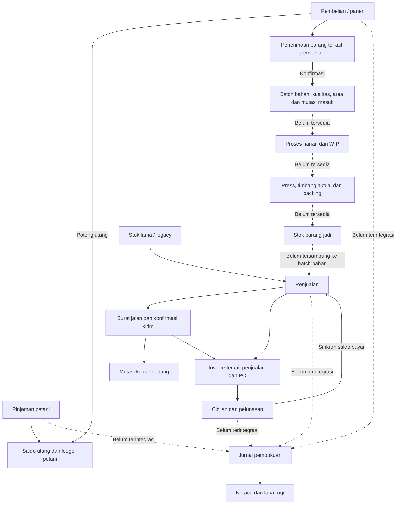

# Audit alur transaksi — 7 Oktober 2026

## Status audit lanjutan — 7 Oktober 2026

**Kode saat ini sudah membuktikan alur dari pembelian/penerimaan, produksi, barang jadi, pengiriman parsial, invoice dan pelunasan sampai jurnal seimbang pada simulasi SQLite memory.** Temuan dan diagram di bagian audit awal di bawah merupakan rekaman sebelum perbaikan, bukan status kode terbaru.

Verifikasi ulang pada sesi lanjutan:

- Audit bisnis: **26 lulus, 154 assertion**. Sebelum perubahan sesi ini, 24 skenario yang sudah tersedia juga lulus.
- Seluruh suite melalui `php vendor/bin/pest --colors=never`: **90 lulus, 1.011 assertion**. Suite default kini mencakup `tests/Audit`; gunakan Pest karena sebagian pengujian memakai sintaks Pest.
- Alur lengkap diuji dari stok jual nol: bahan dikonsumsi oleh produksi, hasil timbang menjadi batch jadi dengan biaya, dua pengiriman parsial menghabiskan stok, cicilan melunasi invoice, HPP dan laba direkonsiliasi dengan neraca.
- Penggantian petani pada pinjaman/pembelian kini ditolak; pengujian menerima penolakan aman tersebut. Saldo utang masih agregat per petani, belum alokasi pembayaran per pinjaman.
- Pengujian memverifikasi kas dari pembayaran aktual, pembayaran petani, pengeluaran dashboard, pembentukan gudang material, relasi invoice, jurnal operasional, pembalik dan periode koreksi pinjaman.

### Perbaikan pada sesi lanjutan

Ditemukan risiko biaya batch terakhir negatif karena setiap baris dibulatkan sendiri lalu seluruh selisih dibebankan ke baris terakhir. Contoh penerimaan bernilai Rp1 dengan enam baris masing-masing 16,66 kg dan satu baris 0,04 kg: pembagian lama menghasilkan enam biaya 17 sen dan biaya terakhir -2 sen. Pada packing, biaya 2 sen dibagi ke empat hasil sama berat menghasilkan 1, 1, 1, -1 sen.

`GoodsReceiptService::valueBatches` dan `ProductionService::pack` kini membulatkan proporsi berat kumulatif, lalu mengambil selisih terhadap alokasi sebelumnya. Total biaya tetap sama, setiap bagian nonnegatif, dan sisa biaya tidak menumpuk sebagai nilai negatif. Dua skenario regresi menguji kedua contoh tersebut serta total biaya batch.

### Pemeriksaan yang masih diperlukan

- Verifikasi migrasi dan tahap inventori pada MySQL aplikasi aktif; sesi ini tidak menjalankan migrasi atau memasukkan transaksi pada database aplikasi.
- Uji konkurensi di MySQL untuk pengambilan batch, konfirmasi kirim dan pembayaran bersamaan; SQLite memory belum membuktikan perilaku penguncian MySQL.
- Pemeriksaan manual antarmuka dan cetak dengan data operasional yang representatif.
- Konfirmasi kebijakan bisnis invoice sebelum kirim dan penagihan pengiriman parsial. Pengujian saat ini membuktikan invoice penuh serta penerimaan pembayaran sebelum kirim melalui akun uang muka, bukan persetujuan kebijakan bisnis tersebut.
- Audit lebih lanjut terhadap data historis, saldo awal dan koreksi transaksi lintas periode selain pinjaman. Kelulusan suite tidak membuktikan bahwa data historis telah direkonsiliasi.

## Rekaman audit awal — sebelum perbaikan

**Kesimpulan: alur belum terhubung utuh dari transaksi petani sampai invoice dan pembukuan.** Relasi di masing-masing modul sudah ada, tetapi jembatan produksi gudang belum diimplementasikan, pembukuan operasional belum terintegrasi, dan beberapa koreksi saldo/laporan masih salah.

Audit ini memeriksa kode, foreign key database MySQL aktif, dan menjalankan simulasi otomatis pada database SQLite `:memory:`. Tidak ada transaksi simulasi yang dimasukkan ke database aplikasi. Perilaku aplikasi belum diubah; berkas tambahan berisi laporan dan pengujian penerimaan untuk temuan yang belum terselesaikan.

## Peta alur



Invoice saat ini boleh diterbitkan sebelum pengiriman; konfirmasi kirim bukan syarat penerbitan. Jika bisnis mengharuskan invoice hanya setelah kirim, diperlukan aturan tambahan. Invoice memakai nilai penuh penjualan, bukan otomatis nilai pengiriman parsial.

## Yang sudah terbukti berjalan

| Tahap | Hasil |
|---|---|
| Pinjaman baru | Menambah utang petani dan ledger dengan referensi pinjaman. |
| Pembelian/panen baru dengan potongan utang yang masih mencukupi | Mengurangi utang, menyimpan nilai pembelian, dan tidak langsung menambah stok. |
| Draft penerimaan | Belum menambah stok atau membuat batch. |
| Konfirmasi penerimaan pada gudang bahan yang valid | Menambah berat aktual dan karung, membuat batch berelasi ke penerimaan/petani/kualitas/area, mencatat selisih berat nota. |
| Konfirmasi ulang | Ditolak; tidak menggandakan stok. Dokumen yang dikonfirmasi dikunci. |
| Penjualan langsung dari stok tersedia | Mengurangi stok satu kali, menyimpan nilai setelah potongan. |
| Penjualan melalui surat jalan | Draft tidak mengurangi stok; konfirmasi kirim mengurangi berat dan karung satu kali. Pengiriman parsial dibatasi total penjualan dan stok. |
| Invoice | Terhubung ke penjualan dan PO; nilai diambil dari penjualan; satu penjualan tidak boleh memiliki dua invoice. Tidak mengurangi stok lagi. |
| Cicilan invoice | Mengurangi sisa tagihan dan menyinkronkan nominal/status bayar penjualan. Kelebihan pembayaran ditolak. |
| Pembayaran utang petani | Mengurangi saldo utang. Penghapusan pembayaran mengembalikan saldo pada skenario normal. |
| Jurnal manual | Pengujian yang tersedia memverifikasi debit/kredit seimbang, saldo awal, penguncian posting, pembalik, dan laporan. Ini tidak membuktikan integrasi transaksi operasional. |

**Batas bukti:** simulasi penerimaan menggunakan gudang yang disetel `material` secara eksplisit. Simulasi penjualan menggunakan stok lama tersendiri 1.000 kg/40 karung. Stok tersebut bukan hasil produksi dari penerimaan, sehingga kedua simulasi tidak membuktikan alur bahan → barang jadi.

## Temuan yang harus diselesaikan

| Prioritas | Temuan | Bukti/dampak | Sumber utama |
|---|---|---|---|
| Kritis | Gudang bahan aktif belum valid | Database aktif memiliki 3 inventori, semuanya `legacy`, dan 4 area penerimaan. Pilihan gudang bahan kosong. Migrasi memanggil seeder langsung, sedangkan `stock_stage` tidak ada di `Inventory::$fillable`; hasil pembentukan inventori kehilangan tahap `material`. Reproduksi migrasi pada simulasi gagal. | `app/Models/Inventory.php`, `database/seeders/GoodsReceivingSeeder.php`, migrasi `2026_10_07_000010` |
| Kritis | Produksi gudang belum tersedia | Proses harian, WIP, press/timbang/packing dan barang jadi masih halaman keterangan. Tidak ada transaksi yang mengonsumsi batch bahan dan menghasilkan stok jadi. Penjualan bahan ditolak, transfer bahan juga ditolak. Dari saldo nol, bahan yang diterima belum dapat menjadi stok jual melalui alur resmi. | `WarehouseDashboardController::stage`, `resources/views/pages/transaction/warehouse/stage.blade.php`, `WarehouseService::assertLegacyInventory`, `SalesService::createSale` |
| Tinggi | Arus kas menghitung tagihan sebagai penerimaan kas | Penjualan/invoice Rp1.000.000 tanpa pembayaran tetap muncul sebagai Cash In Rp1.000.000, bahkan saat belum dikirim. Query menggunakan `sale_date` dan `total_sale_value`. | `CashFlowController::data` |
| Tinggi | Cicilan salah periode dan nominal di laporan kas | Penjualan Oktober dengan cicilan Rp300.000 pada November tidak menampilkan Rp300.000 di November. Laporan belum membaca setiap `invoice_payments.payment_date`/`amount`. Pelunasan langsung juga belum memakai tanggal dan nominal bayar. | `CashFlowController::data`, `InvoicePaymentService` |
| Tinggi | Pembayaran utang petani hilang dari kas masuk | Penerimaan Rp200.000 dari petani mengurangi utang, tetapi Cash In tetap nol. | `CashFlowController::data`, `FarmerPaymentService` |
| Tinggi | Transaksi operasional belum terhubung ke pembukuan | Simulasi pinjaman, pembelian, penerimaan, penjualan, invoice dan cicilan menghasilkan nol jurnal. Neraca/laba rugi hanya membaca jurnal Posted. `source_reference` jurnal berupa teks opsional; belum ada pemetaan akun, jurnal transaksi atau relasi ke sumber operasional. | Service transaksi, `JournalService`, `FinancialReportService::month` |
| Tinggi | Potongan panen dapat melebihi utang | Utang Rp100.000 dan potongan Rp300.000 diterima lewat endpoint; saldo menjadi minus Rp200.000. Belum ada pembatasan/reklasifikasi sisa pembayaran kepada petani. | `StoreHarvestTransactionRequest`, `HarvestTransactionService::createHarvest` |
| Tinggi | Mengganti petani pada pinjaman tidak memindahkan saldo | Pinjaman Rp1.000.000 dipindahkan ke petani B, tetapi utang tetap pada A dan B tetap nol. Ledger juga tetap mengarah ke petani lama. | `LoanService::updateLoan` |
| Tinggi | Mengganti petani pada panen tidak merekonsiliasi saldo | Panen dengan potongan Rp300.000 dipindahkan ke petani B; saldo A tetap Rp700.000 dan B tetap Rp1.000.000. | `HarvestTransactionService::updateHarvest` |
| Tinggi | Menghapus pinjaman yang sudah dilunasi membuat saldo negatif | Pinjaman Rp1.000.000 dilunasi; penghapusan pinjaman tetap diterima dan membuat utang minus Rp1.000.000. Menurunkan nominal pinjaman juga belum menjaga batas saldo. | `LoanService::deleteLoan`, `LoanService::updateLoan` |
| Sedang | Dashboard memakai pengeluaran lama | Pengeluaran Rp50.000 melalui menu keuangan tersimpan di `transactions`, tetapi ringkasan pengeluaran dashboard nol karena membaca `expenses`. Perhitungan laba/dashboard juga memakai seluruh pembelian, belum HPP barang yang terjual. | `DashboardController::stats`, `DashboardController::chartData`, `TransactionService` |
| Sedang | Invoice penjualan langsung dapat mengambil surat jalan penjualan lain | Dua penjualan pada PO sama: invoice penjualan langsung mengaitkan surat jalan milik penjualan lain karena filter hanya PO pada cabang tersebut. | `InvoiceService::withReferences` |

## Kelengkapan relasi

- Pinjaman/panen/pembayaran → petani dan ledger: tersedia, tetapi koreksi petani/nominal dan penghapusan belum aman. Saldo utang dihitung per petani, bukan alokasi pelunasan per pinjaman.
- Penerimaan → pembelian: tersedia dan unik **jika dipilih**. Penerimaan juga diizinkan memakai nomor nota tanpa `harvest_transaction_id`; mode ini tidak otomatis membentuk pembelian atau utang/pembayaran, sehingga belum menjamin semua barang diterima memiliki transaksi keuangan terkait.
- Batch → baris penerimaan → petani/kualitas/area: tersedia. Belum ada relasi lanjutan batch ke proses atau barang jadi.
- Penjualan → inventori/pabrik: tersedia; belum memilih batch jadi, kualitas dan area barang keluar.
- Surat jalan → penjualan/PO → mutasi keluar: tersedia untuk alur kirim; pemeriksaan stok dan pengiriman ganda berjalan.
- Invoice → penjualan/PO/pembayaran: tersedia; referensi surat jalan penjualan langsung perlu diperbaiki.
- Operasional → jurnal/COA/HPP: belum terhubung. Saldo awal pembukuan juga tidak otomatis menjadi saldo operasional stok/utang petani.

## Hasil pengujian

1. Suite bawaan: **63 lulus, 1 gagal**, 852 assertion. Kegagalan bawaan adalah `tests/Feature/ExampleTest.php`: mengharapkan HTTP 200 pada `/`, sedangkan aplikasi memang mengarahkan ke login dengan HTTP 302.
2. Audit penerimaan tambahan: **14 skenario, 3 lulus, 11 gagal**, 44 assertion. Kegagalan di sini membuktikan temuan operasional, bukan error setup. Belum tersedianya produksi dikonfirmasi dari kode, route, schema, dan halaman tahap gudang.
3. Database aplikasi setelah pengujian: seluruh **18 tabel transaksi masih berisi 0 baris**, saldo utang petani nol, stok/karung nol; `accounting_settings.start_date` masih `null`.

Pengujian audit berada di `tests/Audit/BusinessFlowAuditTest.php`, sengaja terpisah dari suite default agar temuan terbuka terlihat jelas. Jalankan dalam PowerShell:

```powershell
$env:APP_ENV = 'testing'
$env:DB_CONNECTION = 'sqlite'
$env:DB_DATABASE = ':memory:'
php vendor/bin/phpunit tests/Audit/BusinessFlowAuditTest.php --testdox --colors=never
```

Pengujian memverifikasi koneksi SQLite memory sebelum menjalankan migrasi. Migrasi May yang memakai ALTER khusus MySQL direpresentasikan dengan kolom setara pada fixture; ini bukan pengujian konkruensi atau pengujian penuh migrasi MySQL.

## Urutan tindak lanjut

1. Benahi pembentukan gudang bahan dan koreksi status inventori bahan yang sudah terlanjur `legacy`, tanpa mengubah gudang lama menjadi bahan secara menyeluruh.
2. Benahi koreksi/penghapusan transaksi petani dan batas potongan utang.
3. Benahi laporan kas berdasarkan pembayaran aktual, termasuk pembayaran petani; selaraskan sumber pengeluaran dashboard.
4. Implementasikan proses harian → WIP → press/timbang/packing → stok jadi dengan jejak batch, kualitas, area, hasil aktual dan biaya.
5. Sambungkan transaksi operasional ke jurnal dengan pemetaan COA, tanggal pengakuan, HPP dan pembalik yang konsisten; jurnal tidak boleh menggandakan transaksi manual.
6. Perketat relasi surat jalan/invoice dan tentukan kebijakan invoice sebelum kirim serta penagihan parsial.
7. Jalankan kembali audit dan satu simulasi lengkap dari saldo nol tanpa menyuntikkan stok jual sebelum pemeriksaan manual akhir.
